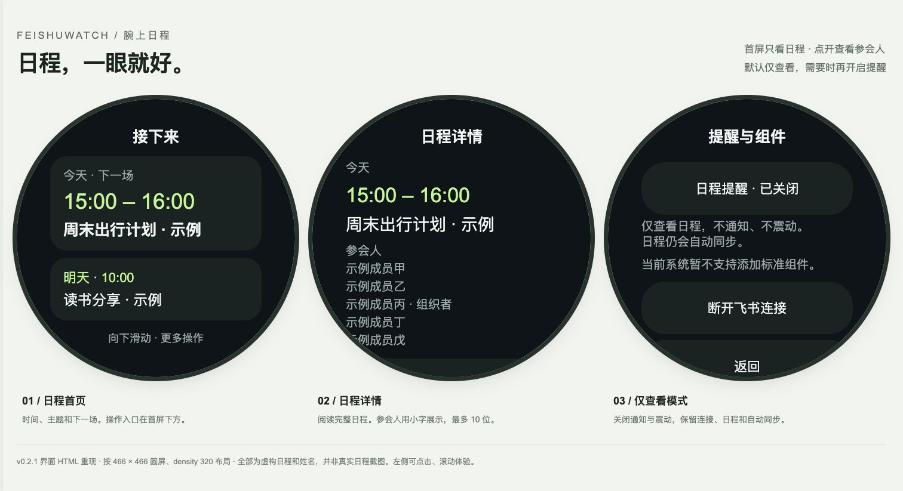

# 腕上日程 · FeishuWatch

[](LICENSE)

在 OPPO Watch 上查看飞书日程和参会人。**默认仅查看，不通知、不震动**；需要时可在设置中开启提醒。目标设备：**OPPO Watch 3 / Android 11 / ColorOS Watch V16.0.0**。

v0.2 默认采用个人直连：首次配置自己的 App ID / App Secret，用手机扫码授权，随后手表直接访问飞书并自动续期。无需自建服务器、域名或内网穿透。凭证运行时配置并使用 Android Keystore 加密，不写入 APK。旧版服务模式保留兼容。

> 开发版。已在连接的 OPPO OWW261 / Android 11 上安装与操作。**当前固件平衡模式把本应用的唤醒闹钟降级为非唤醒，通知中心拒绝展示测试通知，息屏提醒尚未可用。** 标准 AppWidget 不等于 OPPO 原生卡片。详见真机记录。

## 界面预览



按 v0.2.1 的真实布局、字号与颜色制作的 **HTML 重现**，不是原生系统截图。全部日程和姓名均为虚构示例，不包含真实账号信息。

- 首页只展示日程，向下滑动后操作；点击卡片查看全文。
- 详情以小字显示最多 10 位参会人，并标记组织者。
- 「日程提醒」默认关闭；关闭时仍保留登录、缓存和自动同步。

HTML 源码：[docs/preview/index.html](docs/preview/index.html)。下载后直接用浏览器打开，或在仓库目录运行：

```bash
python3 -m http.server 8765 --bind 127.0.0.1 --directory docs/preview
```

访问 `http://127.0.0.1:8765`，左侧手表可点击和滚动体验。预览不会连接飞书，不需要凭证。单页图片：[首页](docs/images/ui-home.jpg) · [详情](docs/images/ui-detail.jpg) · [设置](docs/images/ui-settings.jpg)。

## 功能

- 小字号日程卡片、按日期分组、日程全文与参会人详情。
- 可选的提前 0 / 5 / 10 / 15 分钟系统提醒；开启后默认提前 10 分钟，通知可“稍后 5 分钟”。
- 可关闭的下一场常驻摘要；桌面支持时添加标准下一场日程小组件。
- 7 天日程缓存，24 小时有效；有效缓存中的提醒不依赖网络或 App 页面。
- 同步取消/拒绝/移除的日程后清除旧提醒；改期重排；重启和时区变化后恢复。
- 飞书设备授权扫码，无需回调服务器；手表 Keystore 加密保存个人应用密钥及用户令牌。
- 一键 15 秒测试提醒。debug APK 另有明确标注的虚构日程体验模式。

## 项目结构

```text
app/                 Android 原生应用（Java，API 26+，目标 35）
server/              Node.js 22+ 授权与日程同步服务（无 npm 运行时依赖）
deploy/              Docker Compose + Caddy HTTPS 部署
docs/DESIGN.md       产品、接口、权限、安全和提醒一致性详细设计
docs/SETUP.md        飞书配置、构建、部署及安装
docs/DEVICE_TEST.md  OPPO 真机验收清单
docs/preview/       使用虚构数据的 HTML 界面预览
docs/images/        从 HTML 导出的 README 图片
```

## 本地验证

```bash
npm test --prefix server
# 需要 JDK 17、Android SDK 35；local.properties 配置 sdk.dir
./gradlew testDebugUnitTest assembleDebug lintDebug
```

APK：`app/build/outputs/apk/debug/app-debug.apk`。安装方式：`adb install -r app/build/outputs/apk/debug/app-debug.apk`。首次安装后打开一次应用，完成连接；仅在需要提醒时开启并做真机自检。

构建时可预置服务地址，免去在小屏输入：

```bash
./gradlew assembleDebug -PserverUrl=https://watch.example.com
```

默认仅查看日程；首页下滑进入设置，可按需开启「日程提醒」。关闭时不发通知、不震动、不显示常驻摘要，同步继续。详情页可查看最多十位参会人。

个人直连首次配置见 [SETUP](docs/SETUP.md)。自动化测试使用虚构数据；个人直连已通过真机扫码、主日历同步和 App 冷启动保留登录验证。`server/` 和 `deploy/` 仅供可选的旧版服务模式使用。

## 当前边界

周期同步由 JobScheduler 尝试执行（15 分钟最小周期），系统休眠可能推迟；不会承诺临时改期实时到达。已同步的提醒使用 AlarmManager，仍受系统勿扰、用户禁用通知、强行停止和 OEM 节电策略影响。离线超过 24 小时停止使用过期缓存提醒。

仅同步用户主日历。全天日程只展示，不在午夜震动。暂未接入 OPPO 私有表盘/卡片 SDK、原生日历写入或手机蓝牙同步；这些能力必须先验证设备支持。

后端为单实例部署设计，请保留同一数据卷和 STORE_KEY。不要运行多个副本，否则可能并发消耗一次性刷新凭证。

详细说明：[设计](docs/DESIGN.md) · [部署与连接](docs/SETUP.md) · [真机验收](docs/DEVICE_TEST.md) · [验证记录](docs/VALIDATION.md)

公开前检查范围与结果见 [安全审计记录](docs/SECURITY_REVIEW.md)。不要在 Issue、截图或提交中上传 `.env`、应用密钥、用户令牌或真实日程。

构建后运行 `bash scripts/package.sh`，在 `dist/` 得到 APK、源码 ZIP、部署 tar.gz 和 SHA256SUMS。发布包见 [Releases](https://github.com/ray204/FeishuWatch/releases)。

## 开源协议

项目原创代码、文档和预览资源采用 **AGPL-3.0-only**，完整条款见 [LICENSE](LICENSE)，适用范围见 [COPYRIGHT.md](COPYRIGHT.md)。分发衍生版本时需要遵循相同协议并提供对应源码；将修改版作为网络服务提供时，也须向与之交互的用户提供对应源码。单纯使用软件不会要求公开无关项目。

第三方组件保留原协议，见 [THIRD_PARTY_NOTICES.md](THIRD_PARTY_NOTICES.md)。
