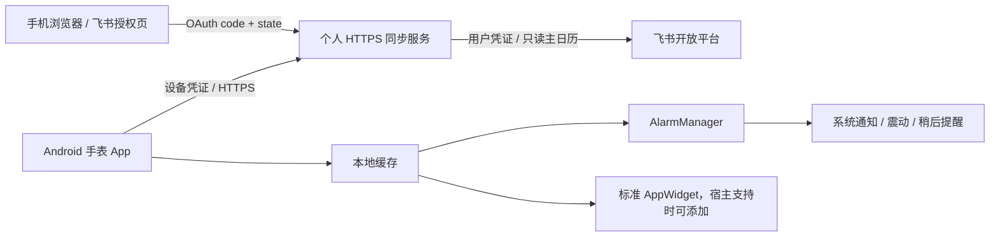

# 腕上日程 / FeishuWatch — 详细设计

状态：首版实施设计。目标设备为用户确认的 OPPO Watch 3、Android 11、ColorOS Watch V16.0.0；配对 Android 手机。本文区分 Android 标准能力与尚未真机验证的 OPPO 能力。

## v0.2 个人直连修订（当前默认）

个人直连模式将应用凭证加密保存在手表。手机访问飞书设备授权页；手表通过 HTTPS 直接向飞书请求设备码、轮询授权、刷新令牌并读取主日历。无需自建域名或入站回调。

- 凭证运行时配置。Keystore AES-GCM 加密的单个 JSON bundle 原子保存应用密钥、设备授权会话、用户令牌和续期状态，禁用系统备份。USB 配置仅暂存在应用私有目录，导入后删除。输入页禁止截图和自动填充保存。
- 设备授权参考[飞书官方 CLI](https://github.com/larksuite/cli/blob/main/internal/auth/device_flow.go)，使用 `accounts.feishu.cn/oauth/v1/device_authorization` 和 `open.feishu.cn/open-apis/authen/v2/oauth/token`。只接受飞书 HTTPS 授权链接。
- 持久化轮询间隔；slow_down 增加间隔；拒绝、到期、取消清除设备码。成功后一次性保存用户令牌并清除设备码。
- 续期前保存“需要重新授权”标记，成功轮换 access/refresh token 后原子提交并清除标记。网络结果不明或进程中断时不重放旧 refresh token。单进程锁保护授权状态，网络在后台线程执行。
- 日历 API 使用 user_access_token。快照验证完成后替换缓存；网络错误不删除有效日程，身份失效使缓存提醒过期。仅主日历与 7 天实例视图。
- 断开连接清除本机凭证与提醒，不等同于飞书端撤销授权。该模式适合个人自建应用，不应把共用企业 Secret 分发给其他人。
- 提醒和标准组件沿用原架构。真机发现 OPPO 平衡模式降级唤醒闹钟且拒绝展示通知，这是独立未解决限制，不使用隐藏 API 或强制全屏绕过。

## v0.2.1 浏览界面与仅查看模式

- 圆屏基线：466×466 px、density 320。横向留白 28dp，顶部 24dp；页面标题 13sp，日程标题 12–13sp，辅助信息及名单 9–10sp，重要时间 18sp。保留系统文字缩放。
- 首屏只展示当前/下一场及后续一场日程。卡片标题最多两行，点击查看全文。使用至少一屏的日程容器，把同步、列表和设置操作放在下滑区域，双列操作 40dp 高；其余按钮 44dp。
- 详情通过现有日程读取权限按需拉取参与人，最多显示十人；会议室和已移除成员不计入名单，群成员展开后按用户 ID 去重，组织者标记。无查看权限时提示，不伪造名单或追加通讯录权限。
- 普通重复实例继承系列参与人；单次例外保留其独立 ID，不拿系列名单替换。详情请求不参与日程快照事务，名单失败不影响提醒或缓存；内存缓存五分钟，离开详情后不覆盖新页面。
- `remindersEnabled` 默认 false。关闭时取消日程/测试闹钟、通知、常驻摘要和稍后提醒，保留登录、日程及同步任务；通知最终投递处也检查开关，防止旧操作重新发出通知。设置中可显式开启，显示相应提醒选项。
- 仅查看模式不请求通知权限。开启提醒仍需按真实机型验收，不能把标准 Android 通知能力视为 OPPO 固件适配完成。

**以下保留 v0.1 服务器模式设计，仅适用于可选的旧模式。**

## 1. 产品目标与完成条件

日常无需打开 App：会前在手表收到系统通知及震动，可在通知上稍后提醒；通知中心常驻下一场摘要（可关闭）。首次在手机扫码连接飞书，之后服务端自动刷新授权。应用只读取主日历，不修改飞书日程。

首版交付：可构建 APK、可运行的授权/同步服务、自动测试、部署说明、真机验收脚本、独立私有 GitHub 仓库及问题跟踪。提醒是否息屏可达、是否展示通知中心、OPPO 桌面是否接纳标准小组件必须另行真机验收，不能以模拟器/编译成功替代。

## 2. 体验与系统集成决策

1. 安装后一次打开：填写服务地址（可通过构建参数预置）→生成二维码→用手机扫码→飞书授权→手表自动连通。手机无需安装配套 App。
2. 首页给出下一场和最近同步状态；设置允许调整提前时间（0/5/10/15 分钟）、常驻摘要及测试提醒；显示权限和节电诊断。默认提前 10 分钟。
3. 系统 AlarmManager 调度本地缓存的日程，在闹钟触发时由 BroadcastReceiver 发出高优先级通知，通知渠道控制震动；不依赖 App Activity 或网络。
4. “稍后 5 分钟”是本地提醒，不修改飞书。到期/取消/拒绝/移除日程不再提醒，修改起始时间后替换旧提醒。同一时刻日程由一次闹钟扫描并逐条通知。相隔过近的闹钟仍可能受 Android Doze 频控约束。
5. 静音的常驻摘要显示当前/下一场，可一键刷新。摘要按缓存事件边界更新，同时重启、同步和小组件刷新时重算。
6. 提供标准 AppWidget（下一场、时间、刷新按钮）。OPPO 桌面是否提供 AppWidgetHost 未确认，文档不声称其等价于 OPPO 原生卡片。没有接入 Wear OS Tiles/Complications：不能把 Wear OS 接口当作 ColorOS Watch 接口。
7. 不用悬浮窗、隐藏 API、强制全屏或忽略勿扰的手段。系统通知受 OEM 策略影响，设置内提供独立延迟测试，实机不展示时需诊断渠道/固件或取得 OPPO 官方 SDK。原生日历桥接可作为后续方案，需要先核验 CalendarProvider 和系统日历消费者，首版不申请日历写入权限。

## 3. 架构

手表使用 Java + Android 原生 UI/JobScheduler/AlarmManager，minSdk 26，主要验证 API 30，target/compile 35；避免 Google Play 服务依赖。后端 Node.js 22+，使用内置 HTTP、fetch、crypto、node:test，单实例、加密文件存储，便于个人部署。

## 4. 认证与安全边界

- 在飞书创建自建应用，开通用户身份只读权限 `calendar:calendar:read`、`calendar:calendar.event:read` 和 `offline_access`，发布到自己可用的范围。以开发者后台实际权限要求为准。
- App Secret 和飞书 refresh/access token 只在服务端。服务数据使用环境变量提供的 32 字节 AES-GCM 密钥加密落盘；临时文件原子替换，文件权限 0600。部署单实例且挂持久卷。
- 手表创建短期绑定会话，二维码只有公开绑定 ID；轮询 secret 仅保存在手表。手机明确点击连接，经带浏览器 cookie 的 OAuth state 校验后换取用户凭证；浏览器拿不到设备凭证。
- 轮询凭证与长期设备凭证分别随机生成；服务端仅用哈希索引设备凭证。绑定结果保留短期重试窗口，避免响应丢失后无法取回。
- 同一账户会话的 refresh 操作串行化，刷新后原子保存轮换凭证；不盲目并发或自动重放一次性 refresh token。超时结果不明时保留旧数据并提示重新授权，不能承诺永久一次登录。
- HTTP 仅用于本机测试（默认 127.0.0.1 监听）；APK 正式配置仅接受 HTTPS。禁止日志记录请求 URL（OAuth code）、Authorization、密钥和日程正文。服务端返回通用错误码。
- 设备凭证用 Android Keystore AES-GCM 加密保存在私有存储，禁止系统备份。解绑删除服务端设备会话、本地缓存、通知和所有提醒；失败时保留连接并显示错误，避免把“仅本地清除”误报为远端撤销。
- 初版单用户/小规模使用；有绑定创建与接口限流、响应大小限制、固定飞书域名，无任意 URL 代理。

## 5. 日程数据与同步

服务用 user_access_token 查询主日历，再调用 `events/instance_view` 获取未来 7 天视图（包含今天已开始的日程）。由飞书展开重复规则及例外，避免自己实现 RRULE。时刻使用 Unix 毫秒，全天日程保留 date 字段，不伪造 UTC 午夜。忽略 cancelled、decline、removed；去重键为实例 event_id。

返回 `{syncedAt, validUntil, events:[{id,title,startMs,endMs,allDay,startDate,endDate,location}]}`。全天日程展示，不安排午夜提醒。同步快照为替换语义：成功的空列表会撤销所有旧事件；HTTP/解析/权限失败不能覆盖有效缓存。

JobScheduler 每 15 分钟尝试同步，需要网络；这是最小间隔，不是准点保证。首页/通知/小组件可立即刷新。后台受系统休眠节流，无法承诺临时改期实时到达。缓存有效期 24 小时，最多预约有效期内的提醒，过期时停止提醒并清楚标记“日程已过期”。断网期间已缓存、未过期的提醒无需联网。任务完成后重新计算本地调度，时间/时区变化、重启、应用升级后恢复。

## 6. 提醒一致性

- 持久保存已投递的 `eventId + startMs + offset` 键，避免同步/重启重复通知。
- 每次成功同步取消之前 PendingIntent，再根据新快照计算未来提醒；触发时再次读当前缓存验证实例及起始时间，防止取消/改期后旧 Intent 误报。
- 同一触发时间共享一个 Alarm，接收器扫描所有到期事项。错过会前提醒时补发一次；允许开始后 1 分钟内的调度抖动，之后不进行历史补发。
- 精确闹钟可用则 `setExactAndAllowWhileIdle`；Android 12+ 没有精确闹钟授权时降级非精确并显示状态。Android 11 不要求此特殊授权。Android 13+ 提供通知权限申请。
- 使用 NotificationChannel 的震动能力并尊重勿扰；不把后台周期同步当作提醒计时器。

## 7. 服务接口

| 接口 | 用途 |
|---|---|
| GET /healthz | 不含凭证的健康检查 |
| POST /v1/pair | 创建 10 分钟绑定会话，返回二维码 URL 和轮询 secret |
| GET /pair/:id | 手机端确认绑定页面 |
| GET /auth/start/:id | 设置 state cookie 后跳转飞书 |
| GET /oauth/callback | 校验 state/cookie，换取授权并完成绑定 |
| POST /v1/pair/poll | Bearer 轮询 secret，返回 pending/已连接设备凭证 |
| GET /v1/agenda | Bearer 设备凭证，返回只读主日历快照 |
| DELETE /v1/device | 撤销本服务设备会话 |

## 8. 验证与发布

自动验证覆盖 OAuth state、过期绑定、非授权访问、refresh 串行化/轮换/失败、加密持久化、日程过滤/全天/改期/取消、闹钟边界与重复防护；HTTP 集成测试使用假的飞书端点，不读取真实用户日程。Android 构建与 lint、纯逻辑 JUnit 测试、可用时模拟器验证通知和重启。

使用 code-testing 技能；运行环境没有名为 test-engineer 的专用 agent，因此按技能要求在本地执行研究→计划→实现→审查，工作记录只放 `.git/testagent/`。语言扩展包未提供，采用 Node 内置测试与 JUnit 4 惯例。

GitHub：新建 ray204/FeishuWatch 私有仓库；main 保存初版、Actions 自动构建/测试并上传 debug APK artifact，Issues 跟踪 OPPO 真机、飞书授权、服务部署和原生组件支持。用户提供的 JustLedger 仅用于识别账号，不修改它。

## 9. 依据及未决项

- [OPPO 穿戴开放平台](https://open.oppomobile.com/new/introduction?page_name=wearabledevice)：Android 应用生态；没有据此推导原生卡片接口。
- [Android AlarmManager 指南](https://developer.android.com/develop/background-work/services/alarms)：精确提醒、休眠限制与授权。
- [Android 通知](https://developer.android.com/develop/ui/compose/notifications/create-notification)：通知渠道、系统呈现。
- [飞书主日历](https://open.feishu.cn/document/server-docs/calendar-v4/calendar/primary)、[日程视图](https://open.feishu.cn/document/calendar-v4/calendar-event/instance_view)、[刷新凭证](https://open.feishu.cn/document/authentication-management/access-token/refresh-user-access-token)。CLI schema 已核验主日历及实例视图字段。
- 真机 ADB、飞书 App ID/Secret、HTTPS 域名和部署机器尚未提供。开发可使用模拟数据与本机后端完成；真实授权与手表效果需要这些外部条件。
- 用户已确认本期先交付本地项目与部署包；真实部署和真机联调记录为 GitHub Issues 后续工作，不作为本期已验证能力。
